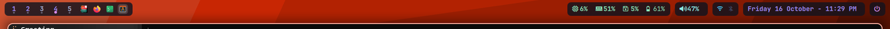
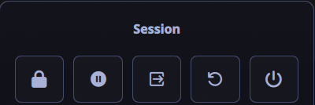

# 🍚 Fedora Rice — Niri + DankMaterialShell *(main)* · Hyprland / ML4W *(fallback)*

A **portable, single-file configuration snapshot** of my Fedora desktop.

- **Main session:** [Niri](https://github.com/YaLTeR/niri) (scrollable tiling) +
  [DankMaterialShell](https://github.com/AvengeMedia/DankMaterialShell) — a
  Material-3 Quickshell desktop: bar, launcher, notifications, wallpaper
  picker, power menu, lock screen.
- **Fallback session:** [Hyprland](https://hyprland.org) on top of
  [ML4W Dotfiles](https://ml4w.com/os/), with a custom **island-style status bar**
  in the spirit of [kovasko/hyprland-dotfiles](https://github.com/kovasko/hyprland-dotfiles).

Both are installed and selectable at the login screen. **Niri is the default.**

Everything lives in **one archive** (`fedora-rice.tar.gz`, ≈ 93 MiB) plus a
`restore.sh` that puts it back. Restoring is idempotent and never deletes
your files.

> **Built and tested on:** Fedora · Niri **26.04** · DankMaterialShell **1.6.3** ·
> Hyprland **0.56.2** · Quickshell **0.3.2** · Ghostty **1.3.1** · matugen **4.2.0** ·
> locale `en_US.UTF-8` · US keyboard · single 1920×1080 display (`eDP-1`).

---

## 🧭 Two sessions, one backup

| Session | Compositor | Shell / bar | Role |
|---|---|---|---|
| **Niri** | niri 26.04 | DankMaterialShell (Quickshell, `dms.service`) | **default** — `Session=niri` in AccountsService |
| Hyprland | Hyprland 0.56.2 via `uwsm` | ML4W + custom kovasko-style island bar | fallback, fully intact |

GDM remembers the last session per user, so Niri stays the default. Pick
**Hyprland** (or **GNOME**) from the gear menu on the login screen whenever you
want the other one. Nothing in this rice removes either session.

---

## 🌊 The Niri desktop

- **Scrollable tiling** with 9 numbered workspaces (dynamic; they appear as pills).
- **4 px gaps**, 2 px focus ring, **12 px** window corners.
- **0.85 window opacity + glass blur** — two `window-rule`s in `config.kdl`:
  windows are semitransparent, and niri 26.04's `background-effect { blur true }`
  blurs whatever is behind each window (xray blur — computed once, shared by
  all windows). The desktop wallpaper itself stays sharp.
- **Material You colours**, generated from the wallpaper by **matugen** and
  written to `dms/colors.kdl` (focus ring / borders / tab indicator / insert hint).
- **DMS top bar:** workspaces · focused window — music · clock · weather —
  tray · clipboard · CPU · RAM · notifications · battery · control centre.
- **Spring animations** on workspace/column movement.
- 12-hour clock, English UI, DMS power menu / lock / wallpaper picker.

### 🗂 Where the Niri config lives

| Path | What it is |
|---|---|
| `~/.config/niri/config.kdl` | Main config: input, layout, animations, window rules and **custom keybinds at the bottom** |
| `~/.config/niri/dms/colors.kdl` | Auto-generated Material-3 palette (matugen) — *don't edit* |
| `~/.config/niri/dms/layout.kdl` | Auto-generated gaps / borders / radius (`4` / `2` / `12`) |
| `~/.config/niri/dms/binds.kdl` | DMS's default Niri keymap (seeded by DMS) |
| `~/.config/niri/dms/{input,outputs,cursor,alttab,windowrules,wpblur}.kdl` | DMS-managed input, outputs, cursor, alt-tab, window rules, wallpaper blur |
| `~/.config/DankMaterialShell/settings.json` | Bar layout + widgets, corner radius, blur flags, cursor settings |
| `~/.local/state/DankMaterialShell/session.json` | Remembered wallpaper |
| `~/.local/share/color-schemes/DankMatugen*.colors` | System colour schemes generated by matugen |

> DMS **owns** the files in `~/.config/niri/dms/` and may regenerate them.
> Anything custom (like the rebinds below) lives in `config.kdl`, which
> `config.kdl` includes *after* `dms/*.kdl` — so custom binds win.

---

## ⌨️ Niri keybindings

Main modifier = **`Mod`** = `SUPER` (the Windows key). Layout is US.

### System & DMS

| Key | Action |
|---|---|
| `Mod` `O` / `Mod` `TAB` | Overview (workspaces + windows) |
| `Mod` `SHIFT` `/` | Keybinding cheatsheet (hotkey overlay) |
| `Mod` `,` | DMS settings |
| `Mod` `Y` | Wallpaper picker |
| `Mod` `N` | Notification centre |
| `Mod` `SHIFT` `N` | Notepad |
| `SUPER` `X` / `Mod` `CTRL` `P` | Power menu |
| `Mod` `ALT` `L` | Lock screen |
| `Mod` `SHIFT` `E` | Quit Niri |
| `Mod` `P` | Cycle display profile |
| `Mod` `SHIFT` `P` | Power off monitors |
| `Mod` `ESCAPE` | Toggle keyboard-shortcuts inhibit |

### Apps

| Key | Action |
|---|---|
| `Mod` `T` / `Mod` `RETURN` | Terminal (Ghostty) |
| `Mod` `SPACE` | DMS launcher (Spotlight) |
| `ALT` `SPACE` | Spotlight bar |
| `Mod` `B` | Default browser |
| `Mod` `E` | Default file manager |
| `Mod` `C` | Visual Studio Code |
| `Mod` `V` | Clipboard history |
| `Mod` `SHIFT` `M` | Task manager |
| `CTRL` `ALT` `DELETE` | Task manager |

### Windows & columns

| Key | Action |
|---|---|
| `Mod` `Q` | Close window |
| `Mod` `F` / `Mod` `M` | Maximize column |
| `Mod` `SHIFT` `F` | Fullscreen |
| `Mod` `SHIFT` `T` | Toggle floating |
| `Mod` `SHIFT` `V` | Switch focus floating ↔ tiling |
| `Mod` `W` | Toggle tabbed column |
| `Mod` `SHIFT` `W` | Create window rule |
| `Mod` `Wheel` | Next / previous workspace |
| `Mod` `CTRL` `Wheel` | Move column to workspace |
| `Mod` `SHIFT` `Wheel` / `Mod` `Wheel` `←→` | Column left / right |

### Focus & movement

| Key | Action |
|---|---|
| `Mod` `←↓↑→` / `Mod` `H` `J` `K` `L` | Focus column / window |
| `Mod` `SHIFT` `←↓↑→` / `Mod` `SHIFT` `H` `J` `K` `L` | Move column / window |
| `Mod` `HOME` / `Mod` `END` | First / last column |
| `Mod` `CTRL` `HOME` / `Mod` `CTRL` `END` | Move column first / last |
| `Mod` `CTRL` `←→` (`H`/`L`) | Focus monitor |
| `Mod` `SHIFT` `CTRL` `←↓↑→` | Move column to monitor |

### Workspaces

| Key | Action |
|---|---|
| `Mod` `1` … `9` | Focus workspace 1–9 |
| `Mod` `SHIFT` `1` … `9` | Move column to workspace 1–9 |
| `Mod` `PAGE_UP` / `PAGE_DOWN` (`I`/`U`) | Previous / next workspace |
| `Mod` `CTRL` `UP` / `DOWN` (`I`/`U`) | Move column to previous / next workspace |
| `Mod` `SHIFT` `PAGE_UP` / `PAGE_DOWN` (`I`/`U`) | Move workspace up / down |
| `CTRL` `SHIFT` `R` | Rename workspace |

### Sizing & screenshots

| Key | Action |
|---|---|
| `Mod` `R` | Cycle preset column width |
| `Mod` `SHIFT` `R` | Cycle preset window height |
| `Mod` `CTRL` `R` | Reset window height |
| `Mod` `CTRL` `F` | Expand column to available width |
| `Mod` `SHIFT` `C` | Centre column |
| `Mod` `-` / `=` | Column width −/+ 10 % |
| `Mod` `SHIFT` `-` / `=` | Window height −/+ 10 % |
| `PRINT` | Screenshot (region) |
| `CTRL` `PRINT` | Screenshot (full screen) |
| `ALT` `PRINT` | Screenshot (window) |

Volume, mute, mic-mute, brightness and media keys work through DMS
(`XF86Audio…`, `XF86MonBrightness…`), including while the screen is locked.

### The binds that were customised

`dms/binds.kdl` is DMS's file, so these live at the end of `config.kdl`:

```kdl
binds {
    Mod+Return { spawn "ghostty"; }
    Mod+B      { spawn "dms" "ipc" "call" "defaultApp" "browser"; }
    Mod+E      { spawn "dms" "ipc" "call" "defaultApp" "fileManager"; }
    Mod+C      { spawn "code"; }
    Mod+Shift+C { center-column; }
    Mod+M      { maximize-column; }
    Mod+Shift+M { spawn "dms" "ipc" "call" "processlist" "focusOrToggle"; }
    Mod+Ctrl+P  { spawn "dms" "ipc" "call" "powermenu" "toggle"; }
}
```

(`Mod+M` was DMS's task manager; it moved to `Mod+Shift+M` to match the
Hyprland habit of `Mod+M` = maximize. `Mod+C` was DMS's centre-column; it
moved to `Mod+Shift+C` so `Mod+C` can launch VS Code — the superseded
entries are commented out in `dms/binds.kdl`.)

---

## 🎨 Theming Niri + DMS

The palette is **derived from the wallpaper**, so changing the wallpaper
re-themes the whole desktop (DMS bar, Niri focus rings, Ghostty, GTK apps):

```bash
dms ipc call wallpaper set ~/Pictures/my-wallpaper.jpg
dms ipc call wallpaper next          # or prev
dms ipc call theme dark|light|toggle # light / dark mode
dms ipc call dash toggle wallpaper   # open the wallpaper browser
```

Other useful knobs:

```bash
dms ipc call settings focusOrToggle  # the full settings GUI
dms ipc call settings dump           # current settings as JSON
dms ipc call bar setPosition top|bottom
dms ipc call bar toggleAutoHide
systemctl --user restart dms         # after hand-editing settings.json
niri validate                        # check config.kdl + dms/*.kdl
```

- **Bar layout / widgets / radius / blur:** `~/.config/DankMaterialShell/settings.json`
  (`barConfigs[].leftWidgets`, `centerWidgets`, `rightWidgets`, `cornerRadius`,
  `blurEnabled`, `blurWallpaperOnOverview`). DMS rewrites this file live, so
  prefer the Settings GUI or `dms ipc call settings set <key> <value>` while it
  is running.
  ⚠️ `blurredWallpaperLayer true` blurs the **whole desktop** (it's a full-screen
  backdrop layer), not just the area behind windows — leave it off if you want a
  sharp wallpaper. App blur comes from the niri rule below instead.
- **Gaps / borders / radius:** `~/.config/niri/dms/layout.kdl` (auto-generated).
- **Window opacity + app blur:** the two `window-rule`s in
  `~/.config/niri/config.kdl` — `opacity 0.85` (semitransparency) and
  `background-effect { blur true }` (niri 26.04, blurs behind windows; needs the
  window to be see-through, hence the opacity rule).
- **Colours:** `dms/colors.kdl` — auto-generated; remove its `include` from
  `config.kdl` if you ever want to set them by hand.

> **Wallpaper caveat — this matters on restore.** DMS stores an **absolute
> path** in `session.json`, and this archive recreates it at the same path
> (`~/Music/wallpapers/6akdqnk4g3se1.png`). If your username differs, restore
> the wallpaper elsewhere and run `dms ipc call wallpaper set <path>`.

> **matugen fix — required for automatic re-theming.** DMS copies
> `~/.config/matugen/config.toml` (the ML4W one, via symlink) to
> `/tmp/matugen-config-*.toml` before running matugen. Four ML4W templates used
> *relative* input paths (`./templates/colors.json`), which no longer resolve
> from `/tmp`, and matugen aborts the whole run with
> `Failed to get the input and output paths from hashmap` — every wallpaper
> change then keeps the old colours. They now use
> `~/.config/matugen/templates/...` instead, which resolves from any directory.
> Symptom: `journalctl --user -u dms | grep -i matugen` shows
> `Matugen failed (v4=true)` on every wallpaper change.

---

## 📋 Requirements

- A **fresh install** of Fedora (this snapshot was taken on **Fedora 44**), or any
  distro that packages Niri + Ghostty + matugen + DankMaterialShell.
- The **base system must already exist** — this archive contains *configuration*,
  **not packages**.
- ≈ 2 GB free disk space (≈ 400 MB for the payload itself).
- An internet connection for the packages below.

---

## 🚀 Installation

### Step 1 — Install the Niri + DMS base

```bash
# Niri itself is in the Fedora repos
sudo dnf install niri

# DankMaterialShell + its companion tools (COPR)
sudo dnf copr enable avengemedia/danklinux
sudo dnf install ghostty matugen
sudo dnf copr enable avengemedia/dms
sudo dnf install dms
```

Log out and pick **Niri** at the login screen once. DMS installs a systemd user
unit (`dms.service`) that Niri's session pulls in (`dms run --session`), so the
bar, launcher, notifications, lock screen and power menu start with the session.

### Step 2 — (optional) Hyprland / ML4W fallback

Only needed if you want the second session too. Follow the official ML4W
instructions → **https://ml4w.com/os/**

```bash
bash <(curl -s https://ml4w.com/os/stable)    # or /rolling
```

Log in once afterwards so ML4W creates `~/.mydotfiles`, the `~/.config/*`
symlinks and the packages, then reboot. This brings in Hyprland, Quickshell,
waybar, kitty, swaync, awww, hypridle, hyprshutdown, rofi/walker, the portals, etc.

### Step 3 — Get this rice

```bash
git clone https://github.com/enn-dee/fedora-rice.git
cd fedora-rice
```

*(Or simply download `fedora-rice.tar.gz` + `restore.sh` by hand — that is all you need.)*

### Step 4 — Restore

```bash
tar -xzf fedora-rice.tar.gz      # extracts  fedora-rice-YYYY-MM-DD/
cd fedora-rice-*/
./restore.sh
```

`restore.sh` is **safe to re-run**. If a real (non-symlink) file is already in
the way, it is moved to `*.pre-rice-restore-<timestamp>` — never deleted.

What it does, in order:

1. `payload/mydotfiles/` → `~/.mydotfiles` (the whole ML4W config tree + wallpapers)
2. `payload/config/` → `~/.config` (niri + DankMaterialShell, plus the extra ML4W/ghostty/cava configs)
3. `payload/local-share/` → `~/.local/share` (fonts, kora icons, ML4W apps, matugen colour schemes)
4. `payload/local-state/` → `~/.local/state` (DMS `session.json`, i.e. the remembered wallpaper)
5. `payload/wallpapers/` → back to the absolute path recorded in `wallpaper-path.txt`
6. `payload/home/` → `~` (`.oh-my-zsh`, `.zsh`)
7. Recreates the `~/.config/*` + `~/.*` symlinks recorded in `symlinks.txt`
8. Refreshes the font and icon caches

### Step 5 — Install the few tools that are *not* bundled

The archive intentionally ships **no binaries** (that is what keeps it a single
portable file). Install these yourself:

```bash
# ── oh-my-posh — the shell prompt used by ~/.config/zshrc/20-customization
#    https://ohmyposh.dev/docs/installation/linux

# ── walker + elephant — the ML4W application launcher (Hyprland fallback)
#    https://github.com/abenz1267/walker
#    https://github.com/abenz1267/elephant

# ── the oh-my-zsh plugins referenced by the zsh config
ZSH_CUSTOM="${ZSH_CUSTOM:-$HOME/.oh-my-zsh/custom}"
git clone https://github.com/zsh-users/zsh-autosuggestions \
    "$ZSH_CUSTOM/plugins/zsh-autosuggestions"
git clone https://github.com/zsh-users/zsh-syntax-highlighting \
    "$ZSH_CUSTOM/plugins/zsh-syntax-highlighting"
git clone https://github.com/zdharma-continuum/fast-syntax-highlighting \
    "$ZSH_CUSTOM/plugins/fast-syntax-highlighting"

# ── DMS plugins are NOT bundled (they are large git checkouts); reinstall from
#    the DMS plugin manager — plugins.lock.json lists what was installed
#    (dmsThemeSync, quickCapture).
```

**Optional — mouse cursor.** The config points at **`Bibata-Modern-Ice`**, which
is *not* bundled:

```bash
# https://github.com/ful1e5/Bibata_Cursor  → extract to ~/.local/share/icons/
# (or install your distro's Bibata package)
```

If you skip it, the system falls back to your distro's default cursor. To use a
different one, change `cursorSettings` in
`~/.config/DankMaterialShell/settings.json` (Niri), and for the Hyprland
fallback `XCURSOR_THEME` in `~/.config/hypr/conf/ml4w.lua` +
`~/.config/hypr/conf/autostart.lua`.

### Step 6 — Log out and back in

```bash
niri validate                     # sanity-check the Niri config first
systemctl --user restart dms      # or just log out / back in
```

Niri reloads `config.kdl` **live** when you save it; DMS reads `settings.json`
on start.

---

## 📦 What's inside the archive

```
fedora-rice-YYYY-MM-DD/
├── README.md          ← short version of this file
├── restore.sh         ← the restore script (safe to re-run)
├── rice-backup.sh     ← the generator, so you can re-snapshot later
├── MANIFEST.txt       ← every single file in the archive
├── symlinks.txt       ← the ~/.config/* + ~/.* symlinks to recreate
├── packages/          ← package list from the source machine
└── payload/
    ├── mydotfiles/    → ~/.mydotfiles      (all ML4W configs + wallpapers)
    ├── config/        → ~/.config          (niri, DankMaterialShell, ml4w-statusbar,
    │                                        ml4w-dock, ml4w-powermenu, ghostty, cava,
    │                                        htop, nwg-look, nwg-displays, dconf, …)
    ├── local-share/   → ~/.local/share     (JetBrainsMono Nerd Font, kora icons,
    │                                        quickshell-overview, ml4w-*, color-schemes)
    ├── local-state/   → ~/.local/state     (DMS session.json)
    ├── wallpapers/    → original path      (active wallpaper + wallpaper-path.txt)
    └── home/          → ~                 (.oh-my-zsh, .zsh)
```

| Path in archive | Restores to | Contents |
|---|---|---|
| `payload/mydotfiles/` | `~/.mydotfiles` | The full ML4W config tree — hypr, quickshell (incl. the custom bar), waybar, rofi, kitty, swaync, walker, zsh, ohmyposh, matugen, wallpapers |
| `payload/config/` | `~/.config` | **Niri** (`config.kdl` + `dms/*.kdl`), **DankMaterialShell** (`settings.json`, `plugins.lock.json`, `firefox.css`), plus the ML4W/ghostty/cava configs that are *not* symlinks |
| `payload/local-share/` | `~/.local/share` | Fonts, icon theme, ML4W Quickshell apps, `color-schemes/DankMatugen*.colors` |
| `payload/local-state/` | `~/.local/state` | DMS `session.json` (remembered wallpaper) |
| `payload/wallpapers/` | original path | The active wallpaper + the path DMS expects it at |
| `payload/home/` | `~` | `.oh-my-zsh`, `.zsh` |
| `symlinks.txt` | — | Recreates the `~/.config/*` + `~/.*` symlinks into `~/.mydotfiles` |
| `packages/` | — | Reference package lists (`dnf`, `pacman`, `apt`, flatpak) |
| `rice-backup.sh` | — | Re-run it to produce a fresh snapshot |

> **Not included on purpose:** binaries (`~/.local/bin/*`), the shell history,
> DMS plugin checkouts (`~/.config/DankMaterialShell/plugins`, ~143 MB of git
> repos — reinstallable), and DMS caches.

---

## 🔁 Updating the backup

```bash
~/.local/bin/rice-backup                      # → ~/fedora-rice-YYYY-MM-DD.tar.gz
cp ~/fedora-rice-$(date +%F).tar.gz fedora-rice.tar.gz
git add -A && git commit -m "refresh rice snapshot" && git push
```

---

## 🍚 Fallback session: Hyprland / ML4W



<p align="center">
  
</p>

The Hyprland side is the original rice of this repository, kept intact:

| Feature | Detail |
|---|---|
| **Custom status bar** | Quickshell, island style, runs as its own `qs -p` instance. The stock ML4W bar is **disabled** (and easily re-enabled). |
| **5 workspaces** | Occupied workspaces show their number; the **active one is a glowing dot**. |
| **App icons** | Icons of every open app appear right of the workspaces. |
| **12-hour clock** | `Friday 16 October - 11:29 PM` |
| **English UI** | Session / network / Bluetooth pop-ups fully translated. |
| **`Esc` closes any bar menu** | Real keyboard focus via layer-shell *exclusive* keyboard mode. |
| **Working session menu** | Every button works: lock · suspend · logout · reboot · shutdown. |
| **AZERTY-aware keybinds** | Workspace digits auto re-map on French / Belgian layouts. |

**Bar layout, left → right:**

```
[ 1 2 3 4 5  🖥 🍎 🐍 🗂 ]   …   [ CPU  RAM  DISK  BAT ]  [ VOL ]  [ NET  BT ]  [ Friday 16 October - 11:29 PM ]  [ ⏻ ]
   workspaces + app icons                              metrics      volume     network     clock                          power
```

### Hyprland keybindings

Main modifier = **`SUPER`** (the Windows key).

| Key | Action |
|---|---|
| `SUPER` `RETURN` | Terminal (kitty) |
| `SUPER` `B` / `SUPER` `E` / `SUPER` `C` | Browser / file manager / VS Code |
| `SUPER` `SPACE` | Application launcher |
| `SUPER` `1` … `5` / `SHIFT` | Switch workspace / move window there |
| `SUPER` `Q` / `SHIFT` `Q` | Close window / all instances |
| `SUPER` `F` / `SUPER` `M` | Fullscreen / maximize |
| `SUPER` `T` / `ALT` `T` | Toggle floating / floating + pinned |
| `SUPER` `←↑↓→` (+`ALT`, +`SHIFT`) | Focus / swap / resize |
| `SUPER` `PRINT` / `ALT` `F` / `ALT` `S` / `ALT` `A` | Screenshot / full / area / OCR |
| `SUPER` `V` | Clipboard history |
| `SUPER` `CTRL` `L` / `CTRL` `P` | Lock / power menu |
| `SUPER` `SHIFT` `M` / `SHIFT` `W` / `CTRL` `W` | Light-dark / random wallpaper / wallpaper picker |
| `SUPER` `CTRL` `K` / `SHIFT` `R` | Cheatsheet / reload Hyprland |

The custom bar lives in **`~/.config/quickshell/kovasko-statusbar/`**
(`shell.qml` = layout, `Theme.qml` = colours/radii, `modules/*.qml` = widgets).
Reload it with:

```bash
ps -eo pid,comm,args --no-headers \
  | awk '$2=="qs" && /kovasko-statusbar/ {print $1}' | xargs -r kill
setsid qs -p "$HOME/.config/quickshell/kovasko-statusbar" >/dev/null 2>&1 &
```

Its autostart lives in `~/.config/ml4w/scripts/ml4w-autostart`; the stock ML4W
bar can be re-enabled with `"enabled": true` in
`~/.config/ml4w-statusbar/config.json`.

---

## 🩺 Troubleshooting

**The DMS bar is missing (Niri)**

```bash
systemctl --user status dms        # should be active (running)
systemctl --user restart dms
journalctl --user -u dms -n 100 --no-pager
```

**Niri rejects a config change**

```bash
niri validate                      # prints the first error, if any
```

Niri also shows the error in a notification on save. The last known-good file
is kept in the archive payload if you need to compare.

**A keybinding does nothing**

```bash
Mod+SHIFT+/        # hotkey overlay — lists what actually got bound
```

Check `~/.config/niri/config.kdl` (your custom binds, applied last) and
`~/.config/niri/dms/binds.kdl` (DMS defaults). A key defined twice *inside one
`binds { }` block* is an error; across blocks the later one wins.

**The wallpaper didn't come back after restoring**

```bash
dms ipc call wallpaper set <path>   # absolute path, the one in wallpaper-path.txt
```

**The Hyprland bar is missing**

```bash
pgrep -a qs        # you should see TWO processes:
                   #   qs                                    (ML4W theme manager)
                   #   qs -p /home/<you>/.config/quickshell/kovasko-statusbar
qs -p ~/.config/quickshell/kovasko-statusbar    # run it in the foreground to see QML errors
```

**Hyprland complains about the config**

```bash
hyprctl configerrors
```

**The status bar covers my windows / windows hide under it**
It is a Wayland layer-shell panel and reserves its own space (30 px + 5 px margin
= 35 px). If the stock ML4W bar is also enabled you get two bars — disable one.

**My Hyprland keybindings don't work**
`SUPER` `CTRL` `K` for the cheatsheet, `SUPER` `SHIFT` `R` to reload. Check
`~/.config/hypr/conf/keybindings/default.lua` — the workspace keys are computed
at load time from `~/.config/hypr/input.lua`.

**The zsh prompt looks broken / `[oh-my-zsh] plugin '…' not found`**
`oh-my-posh` is not bundled, and the three zsh plugins must be cloned — see *Step 5*.

**The cursor is the wrong shape / theme**
The config references `Bibata-Modern-Ice`; install it or change the name.

---

## 🙏 Credits

- **[Niri](https://github.com/YaLTeR/niri)** by Ivan Molodetskikh.
- **[DankMaterialShell](https://github.com/AvengeMedia/DankMaterialShell)** by
  AvengeMedia — the Material-3 Quickshell desktop used by the main session.
- **[matugen](https://github.com/InioX/matugen)** — Material You colour generation.
- **[ML4W Dotfiles](https://github.com/mylinuxforwork/dotfiles)** by Stephan Raabe —
  the Hyprland base system (GPL-3.0).
- **[kovasko/hyprland-dotfiles](https://github.com/kovasko/hyprland-dotfiles)** —
  the island bar this one is modelled on. *That repository declares no license —
  if you plan to redistribute the bar itself, ask its author first.*
- **[JetBrainsMono Nerd Font](https://github.com/ryanoasis/nerd-fonts)** (SIL OFL 1.1).
- **kora** icon theme.
- **[oh-my-posh](https://ohmyposh.dev)** — the `zen` theme for the shell prompt.

## 📄 License

This repository is a **personal configuration snapshot**, shared as-is for
anyone who wants to reproduce the look.

- The **ML4W parts** remain under **GPL-3.0** — see upstream.
- The **island status bar** derives from kovasko's work, which carries **no
  declared license**.
- Niri, DankMaterialShell and matugen keep their own licenses.
- Everything written specifically for this rice may be used freely for personal
  setups.

Please keep the credits above if you fork this.
